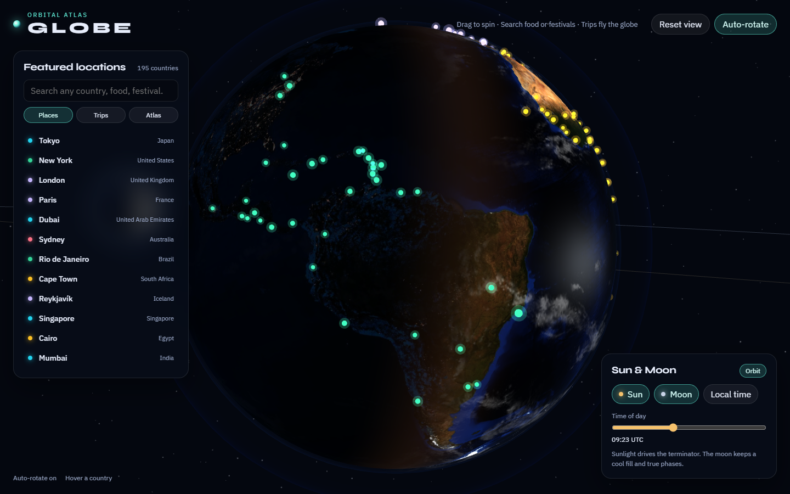

# Globe — 3D Orbital Atlas

A full-viewport **3D Earth** you can drag, search, and travel. Country and city dossiers cover culture, food, heritage, rankings, polaroid photos, story trips, and a day/night sun.

## About this version

Version 1.1 keeps the whole atlas and makes the globe lighter to run and quicker to build.

- Search, places, trips, dossiers, pins, compare, sound, borders, the India claim, and the sun and moon are the same features as before.
- The wide view still shows one dot per country. Gold division dots still appear only when you zoom in, below distance 3.75.
- Hover and click use the same pick sizes. A selected division stays visible if you zoom back out.
- While the globe is spinning far away, only the country dots are drawn. The division dots go to the GPU when you come close.
- The desktop Earth stays the full 512×256 mesh. Tablets and phones use a coarser sphere so they stay smooth.
- Mountain shading fades in as you approach the surface and stays quiet on the wide view.
- Panels stay readable as solid dark glass, without blurring the moving globe every frame.
- The production build splits Three.js from the atlas data, so a code change does not force the atlas to download again.



## Tutorial video

Watch a short walkthrough of the main features (globe, search, India dossier, Kolkata, trips):

https://github.com/Ronty00/3d-globe/raw/main/docs/tutorial.mp4

<video src="docs/tutorial.mp4" controls width="100%" poster="docs/poster.png">
  <a href="docs/tutorial.mp4">Download the tutorial video</a>
</video>

If the player does not show in your viewer, open [`docs/tutorial.mp4`](docs/tutorial.mp4) directly.

### What the video shows

1. The spinning globe, atmosphere, and location markers  
2. Search **India** and open the full-screen dossier  
3. **Culture**, **Places** (states & cities), and **Rankings**  
4. Search **Kolkata** — visit strip, Durga Puja, food, heritage polaroids  
5. **Trips** (Silk Road, monsoon cities, partition, spice, night cities)

## Run it

```bash
npm install
npm run dev
```

Open [http://localhost:5173](http://localhost:5173).

```bash
npm run build
npm run preview
```

## How to use

| Action | What happens |
| --- | --- |
| Drag | Spin the globe |
| Scroll | Zoom in close. The ground has mountain and ocean relief |
| Click a marker | Fly to that country |
| Zoom in | Gold dots for each country's first-level divisions |
| Borders | Country outlines drawn on the Earth |
| Search | Countries, cities, food, festivals (`fuchka`, `Durga Puja`) |
| **Places / Trips / Atlas** | Featured cities, camera stories, pinned places |
| **Pin** | Saves to Atlas and to `?pins=` in the URL |
| **Compare** | Pick a second city — distance, food, arc on the globe |
| **Morning there** | Moves the sun over that place |
| **Sound** | Optional quiet ambience (off by default) |
| Click a polaroid | Full image; drag to rotate, scroll to zoom |

Photos are copied from Wikimedia Commons as local data URLs and shown with author + license credit.

## Stack

- [Vite](https://vitejs.dev/) + [Three.js](https://threejs.org/)
- Custom Earth day/night shader, atmosphere, clouds, sun and moon
- Country borders and first-level divisions for 195 countries
- Closer zoom, terrain relief, and layouts for phones, tablets, and desktops
- Country rankings (Happiness, Henley passport, Global Firepower, IMF GDP, HDI, GPI)
- City catalogs for India and featured places around the world

## License

MIT
